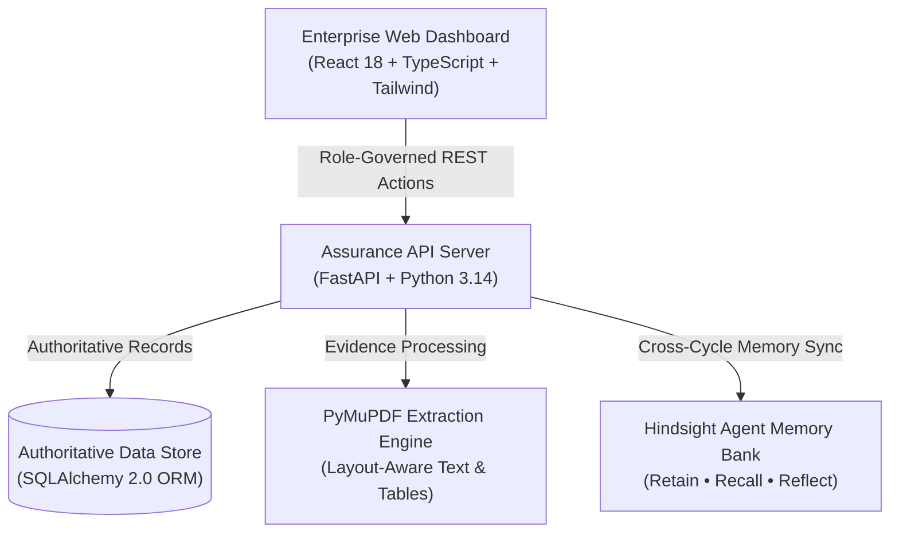

# Why Stateless AI Fails Enterprise Audits: Building Memory-Driven Compliance with Hindsight

Enterprise security and continuous compliance have a persistent, structural problem: audits are inherently cyclical, but the systems that manage them operate with total amnesia.

Every quarter, internal audit teams and compliance officers review dozens of security controls across access management, encryption, and vulnerability response. In almost every enterprise, the same operational gaps recur cycle after cycle. A database access review SLA is missed in January. A quick spreadsheet is uploaded in February to unblock the audit. But by July, the exact same deficiency re-emerges in the exact same department—costing organizations hundreds of engineering hours in redundant investigation and regulatory friction.

When teams attempt to solve this with standard LLMs and traditional Retrieval-Augmented Generation (RAG), they quickly hit a wall. Traditional RAG is stateless; it retrieves similarity matches from static policy PDFs, but it has no temporal comprehension of an organization’s *historical trajectory*. It cannot differentiate between a first-time gap and a chronic 3-cycle recurrence, nor can it track whether a remediation truly fixed an underlying cause or merely applied a temporary cosmetic patch.

To solve this, we built **AuditMind AI**, an enterprise continuous compliance and assurance platform powered by [Vectorize agent memory](https://vectorize.io/what-is-agent-memory) and [Hindsight](https://github.com/vectorize-io/hindsight).

---

## What AuditMind AI Does and How It Hangs Together

AuditMind AI brings four connected capabilities into a unified assurance workflow:

1. **Continuous Compliance Monitoring**: An authoritative control register (inspired by ISO/IEC 27001) tracking 20 controls across Governance, Access Control, Cryptography, and Incident Response.
2. **Audit History & Organizational Memory**: A persistent memory system that records audit findings, remediation actions, and review decisions across chronological cycles.
3. **Predictive Risk Early-Warning**: A transparent, deterministic 0–10 risk scoring engine that flags fragile controls before external auditors arrive.
4. **Automated Evidence Verification**: Layout-aware document extraction that verifies audit artifacts against control expectations with human-in-the-loop review queues.

The architecture comprises a high-throughput backend built on FastAPI and SQLAlchemy, an evidence verification pipeline powered by PyMuPDF (`fitz`), a React 18 / TypeScript frontend with role-governed workflows, and a persistent memory bank powered by [Hindsight](https://hindsight.vectorize.io/).



---

## The Core Technical Story: Solving the Chronic Recurrence Problem

To understand why agent memory is indispensable, consider a real scenario we observed repeatedly in enterprise IT operations: **Control SEC-014 (User Access Management & Periodic Review)**.

### Cycle 1 (January 2026): The Initial Defect
During the Q1 audit, the assurance pipeline extracts an audit observation: 14 privileged database accounts in IT Operations had not undergone periodic manager recertification. When the compliance officer approves this finding, AuditMind AI calls Hindsight’s `retain` API to persist the structured memory:

```python
# Retain audit memory upon human approval
hindsight_client.retain(
    bank="abctech-audit-memory",
    content=(
        "Audit Finding SEC-014 (IT Operations): 14 privileged database accounts "
        "were uncertified during Q4 review. Missing manager sign-off signatures."
    ),
    metadata={
        "control_code": "SEC-014",
        "department": "IT Operations",
        "audit_period": "2026-Q1",
        "severity": "High",
        "entity_type": "finding"
    }
)
```

### The Remediation (February 2026): A Fragile Patch
The IT Operations manager creates remediation action `REM-2026-014-01`, submitting an ad-hoc spreadsheet recertifying the accounts. The finding is marked resolved, and the control status returns to compliant. Crucially, the remediation addressed the immediate symptom (clearing the backlog) rather than the root cause (establishing an automated recurring review cadence).

### Cycle 2 (April 2026): Hindsight Recall in Action
Three months later, the Q2 audit document is ingested. A new draft finding is flagged: periodic access review logs are incomplete for the database tier.

Without memory, a standard AI agent treats this as an isolated finding with moderate priority. But AuditMind AI automatically executes a `recall` query:

```python
# Recall past cross-cycle context
recalled_memories = hindsight_client.recall(
    bank="abctech-audit-memory",
    query="periodic access review incomplete database accounts IT Operations",
    filter={"control_code": "SEC-014"}
)
```

Hindsight surfaces the January finding and February spreadsheet remediation. Instead of presenting a generic summary, AuditMind AI runs a `reflect` step:

```python
# Synthesize historical pattern
reflection = hindsight_client.reflect(
    bank="abctech-audit-memory",
    context=recalled_memories,
    prompt="Determine if this finding is a chronic recurrence of prior remediated weaknesses."
)
```

The system immediately flags a **Recurrence Pattern** with a high confidence match score:
> *"Recurrence detected: Similar access-review deficiency identified in IT Operations 90 days post-remediation. Prior action REM-2026-014-01 relied on manual spreadsheets without establishing an automated schedule."*

### Cycle 3 (July 2026): SLA Breach & Predictive Escalation
By July, the same review is overdue by more than 45 days. Because the platform remembers that this is a repeated defect, its deterministic risk score automatically jumps to **9.1 / 10 (Critical Early Warning)**, escalating it to executive leadership weeks before external auditors arrive.

---

## Transparent, Code-Backed Predictive Risk Scoring

Many enterprise compliance tools claim to provide "AI-powered risk ratings," but they operate as unexplainable black boxes that audit committees reject. In AuditMind AI, every risk score is deterministically calculated using an auditable formula:

$$\text{Risk Score} = \text{Severity Points} + \text{Recurrence Points} + \text{Overdue Days} + \text{Evidence Gap}$$

Here is the exact implementation from our risk scoring engine:

```python
def calculate_finding_risk(finding: Finding, db: Session) -> RiskAssessment:
    """Calculate transparent 0-10 risk indicator with component reasons."""
    # 1. Base Severity (1.0 to 3.0 pts)
    severity_map = {"High": 3.0, "Medium": 2.0, "Low": 1.0}
    base_points = severity_map.get(finding.severity, 1.0)
    
    # 2. Hindsight Recurrence History (0.0 to 3.0 pts)
    recurrence_points = 3.0 if finding.is_recurrence else 0.0
    
    # 3. Overdue Remediation Impact (0.0 to 2.0 pts)
    overdue_days = get_overdue_days(finding.id, db)
    overdue_points = min(2.0, overdue_days * 0.05) if overdue_days > 0 else 0.0
    
    # 4. Evidence Weakness (0.0 to 2.0 pts)
    evidence_points = calculate_evidence_gap_penalty(finding.control_id, db)
    
    total_score = round(min(10.0, base_points + recurrence_points + overdue_points + evidence_points), 1)
    
    return RiskAssessment(
        score=total_score,
        level="Critical" if total_score >= 8.0 else "High" if total_score >= 6.0 else "Moderate",
        breakdown={
            "severity_base": base_points,
            "recurrence_penalty": recurrence_points,
            "overdue_penalty": overdue_points,
            "evidence_gap_penalty": evidence_points
        }
    )
```

Every score rendered in the UI is fully decomposed so compliance officers can inspect the exact contribution of each factor.

---

## Verifiable Evidence Grounding with PyMuPDF

Enterprise auditors do not trust ungrounded AI summaries. To make every assertion verifiable, AuditMind AI pairs layout-aware PDF extraction via PyMuPDF with a slide-over **Source Document Drawer**.

When an auditor inspects any finding or asks a question in the AI Audit Assistant, the platform provides clickable citation chips linking directly to the cited page and excerpt:

```python
def extract_page_verbatim(pdf_path: str, page_number: int) -> dict:
    """Extract page text using PyMuPDF preserving structural reading order."""
    import fitz  # PyMuPDF
    doc = fitz.open(pdf_path)
    page = doc.load_page(page_number - 1)
    text = page.get_text("text")
    doc.close()
    return {
        "page": page_number,
        "text": text,
        "char_count": len(text)
    }
```

The auditor can verify the original text side-by-side with the AI findings, ensuring complete traceability.

---

## Role-Based Governance: Segregation of Duties

An enterprise compliance application cannot treat all users equally. AuditMind AI enforces role-based boundaries directly across all screens:

- **Alice Admin (`admin`)**: Superuser configuration, user management, and system-wide overrides.
- **Carlos Compliance (`compliance_officer`)**: Authorized to approve draft findings into authoritative records, accept evidence assessments, and sign off completed remediations.
- **Owen Owner (`control_owner`)**: IT Operations manager responsible for updating remediation progress (`In Progress`, `Ready for Review`). Crucially, segregation of duties prohibits Owen from approving findings or certifying his own remediation completions.
- **Audrey Auditor (`auditor`)**: Independent oversight role. Audrey operates in a read-only capacity on controls and remediations, but has full authority to interrogate the audit assistant and review evidence.

---

## Key Lessons Learned Building with Agent Memory

1. **Memory must be temporal, not just semantic**: Traditional vector similarity search finds documents that sound alike. Enterprise memory requires understanding *when* an event happened, what changed afterward, and whether a remediation succeeded or failed.
2. **Deterministic guardrails preserve auditor trust**: Use AI for extraction, correlation, and memory synthesis, but enforce state transitions, risk formulas, and access controls deterministically.
3. **The human-in-the-loop is non-negotiable**: AI suggestions must remain in a `Draft` state until an authorized human reviews and signs off. This simple rule prevents hallucinations from corrupting the authoritative audit register.

---

## Conclusion

Continuous compliance is not a document search problem—it is an organizational memory problem. By combining deterministic assurance workflows with [Hindsight](https://github.com/vectorize-io/hindsight) persistent memory, AuditMind AI enables enterprises to transition from reactive, painful audit cycles to continuous, self-improving assurance posture.
