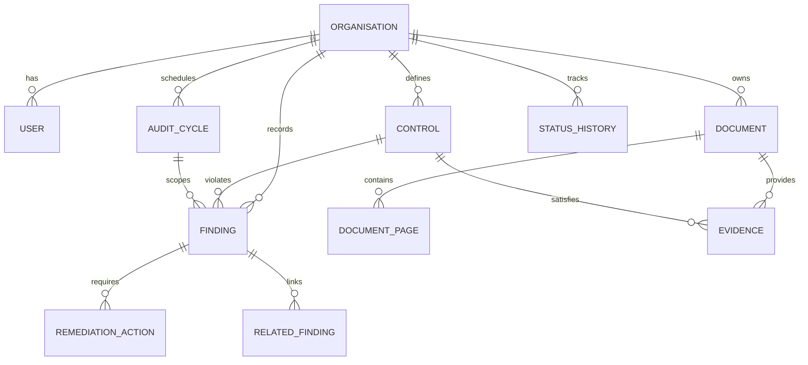

# System Architecture — AuditMind AI

AuditMind AI is an AI-assisted compliance intelligence and continuous audit management platform. It operates as an audit-support system for compliance officers, auditors, and control owners, providing continuous visibility and audit history intelligence across multi-cycle audit programs without autonomous decision-making.

---

## 1. System Layers & Architecture

```
┌────────────────────────────────────────────────────────────────────────┐
│                        Browser Client                                  │
│             React 18 + Vite 5 + TypeScript 5 + Tailwind CSS 3          │
│                      Recharts + React Router 6                         │
└───────────────────────────────────┬────────────────────────────────────┘
                                    │ HTTP / JSON (REST)
                                    │ X-User-Id header auth
┌───────────────────────────────────▼────────────────────────────────────┐
│                       FastAPI Application                              │
│              Python 3.14 + FastAPI 0.111+ / Uvicorn                    │
│                                                                        │
│  ┌──────────────────────────────────────────────────────────────────┐  │
│  │                          API Routers                             │  │
│  │   /api/users          /api/controls         /api/audit-cycles    │  │
│  │   /api/findings       /api/remediations     /api/documents       │  │
│  │   /api/evidence       /api/history          /api/health          │  │
│  └──────────────────────────────────┬───────────────────────────────┘  │
│                                     │                                  │
│  ┌──────────────────────────────────▼───────────────────────────────┐  │
│  │                         Service Layer                            │  │
│  │  • status.py       — Finite state machine & immutable history    │  │
│  │  • compliance/     — Deterministic rule & regex verifier         │  │
│  │  • history/        — Cross-cycle recurrence & timeline engine    │  │
│  │  • risk/           — Illustrative early-warning scoring (0-10)   │  │
│  │  • documents/      — PyMuPDF (fitz) text & layout extraction     │  │
│  │  • llm/            — Optional provider (Groq / Gemini / None)    │  │
│  └──────────────────┬──────────────────────────────┬────────────────┘  │
│                     │                              │                   │
│        SQLAlchemy 2.0 ORM                          │ Raw text stream   │
│                     │                              │ (untrusted data)  │
│  ┌──────────────────▼──────────┐        ┌──────────▼────────────────┐  │
│  │     Relational Database     │        │     External Services     │  │
│  │    SQLite / PostgreSQL      │        │  • PyMuPDF (in-process)   │  │
│  │  11 core relational tables  │        │  • Groq / Gemini (opt.)   │  │
│  └─────────────────────────────┘        └───────────────────────────┘  │
└────────────────────────────────────────────────────────────────────────┘
```

---

## 2. Relational Data Model

### Key Entities

1. **`organisations`**: Core multi-tenant boundary. Every operational entity carries `organisation_id`.
2. **`users`**: Tenant actors with explicit roles (`admin`, `compliance_officer`, `control_owner`, `auditor`).
3. **`controls`**: ISO 27001-inspired register. Stores human-verified `status`, category, review cadence (`annual`, `quarterly`, `monthly`), and verification expectations.
4. **`documents`**: Ingested compliance documents (e.g. `audit_report`, `policy`, `evidence`).
5. **`document_pages`**: PyMuPDF-extracted text pages stored with 1-based page indices.
6. **`evidence`**: Document mapped to a specific control with an evaluation assessment (`Candidate Match`, `Missing`, `Expired`, `Incomplete`, `Requires Human Review`) and approval status.
7. **`audit_cycles`**: Time-bounded audit cycles (e.g. January 2026, April 2026, July 2026).
8. **`findings`**: Identified audit issues linked to controls and cycles, recording severity, excerpt, recurrence status, and review status (`Draft`, `Approved`, `Rejected`).
9. **`remediation_actions`**: Action items attached to findings with assigned owner, status lifecycle, and due dates.
10. **`status_history`**: Append-only audit trail capturing every status transition, actor ID, timestamp, and review rationale.
11. **`related_findings`**: Cross-cycle finding recurrence links computed via deterministic similarity scoring.
12. **`activity_log`**: System activity tracking for auditing, ingestion, and extraction events.

### Entity-Relationship Diagram



---

## 3. Implemented API Routes

All application routes are registered under the `/api` prefix and require tenant context:

| Category | Method | Path | Summary & Guards |
|---|---|---|---|
| **Meta** | `GET` | `/api/health` | System health check (`200 OK`) |
| **Users** | `GET` | `/api/users/me` | Current authenticated user profile |
| **Controls** | `GET` | `/api/controls` | List controls with read-only `computed_status` signal |
| | `POST` | `/api/controls` | Create new control (`admin`, `compliance_officer`) |
| | `GET` | `/api/controls/{control_id}` | Retrieve specific control details |
| | `PATCH` | `/api/controls/{control_id}` | Update control metadata (`admin`, `compliance_officer`) |
| | `POST` | `/api/controls/{control_id}/status` | Transition control status with immutable history logging |
| | `GET` | `/api/controls/{control_id}/history` | Chronological status history for control |
| **Audit Cycles** | `GET` | `/api/audit-cycles` | List audit cycles for organization |
| | `POST` | `/api/audit-cycles` | Create an audit cycle (`admin`, `compliance_officer`, `auditor`) |
| | `GET` | `/api/audit-cycles/{cycle_id}` | Get specific audit cycle metadata |
| **Findings** | `GET` | `/api/findings` | Filterable findings list (`control_id`, `department`, `status`, etc.) |
| | `POST` | `/api/findings` | Create finding (`admin`, `compliance_officer`, `auditor`) |
| | `GET` | `/api/findings/{finding_id}` | Get specific finding record |
| | `PATCH` | `/api/findings/{finding_id}` | Update finding metadata |
| | `POST` | `/api/findings/{finding_id}/status` | Transition finding status (guard: closed requires completed remediation) |
| | `POST` | `/api/findings/{finding_id}/approve` | Approve draft finding & trigger recurrence detection |
| | `POST` | `/api/findings/{finding_id}/related/{related_id}/review` | Confirm or reject recurrence suggestion |
| | `GET` | `/api/findings/{finding_id}/history` | Status history and related finding suggestions |
| **Remediation** | `GET` | `/api/remediations` | List remediation actions (computes `is_overdue`) |
| | `POST` | `/api/remediations` | Create action (`admin`, `compliance_officer`, `control_owner`) |
| | `GET` | `/api/remediations/{action_id}` | Get single remediation action |
| | `PATCH` | `/api/remediations/{action_id}` | Update remediation metadata |
| | `POST` | `/api/remediations/{action_id}/status` | Transition action status (`auditor` denied, `Completed` restricted) |
| **Documents** | `GET` | `/api/documents` | List uploaded documents |
| | `POST` | `/api/documents` | Multipart upload with magic-byte and size validation |
| | `GET` | `/api/documents/{doc_id}` | Single document details with extracted page count |
| | `GET` | `/api/documents/{doc_id}/pages/{page_number}` | View extracted text for single page |
| | `POST` | `/api/documents/{doc_id}/process` | Trigger synchronous PyMuPDF page text extraction |
| | `POST` | `/api/documents/{doc_id}/analyze` | Trigger compliance verification and draft finding extraction |
| **Evidence** | `GET` | `/api/evidence` | List evidence records with optional filters |
| | `GET` | `/api/evidence/{ev_id}` | Get single evidence record |
| | `POST` | `/api/evidence/map` | Manually map document to control (`Draft` state) |
| | `POST` | `/api/evidence/{ev_id}/review` | Approve/reject evidence assessment (`compliance_officer`, `auditor`) |
| **History** | `GET` | `/api/history/timeline` | Full chronological audit timeline for control (`control_id` or `control_code`) |

---

## 4. Security & Compliance Architecture

### Tenant Isolation
Every database table holding operational data includes an `organisation_id` foreign key. Authentication dependencies (`_get_current_user`) resolve the user's organization context, and every service and database query rigorously filters by `organisation_id`. Cross-tenant data leakage is structurally prevented at the data access layer.

### Role-Based Access Control (RBAC)
Four distinct roles are enforced across endpoints:
- **`admin`**: System configuration, user management, and full compliance administration.
- **`compliance_officer`**: Authoritative approver for findings, evidence reviews, and control status transitions.
- **`control_owner`**: Responsible for implementing remediations; restricted from closing findings or approving assessments.
- **`auditor`**: Independent reviewer; possesses read-access and finding creation permissions, but cannot update or close remediation items.

### Append-Only Status Audit Trail
Entity status changes are never overwritten in-place without documentation. The `StatusHistory` table is strictly insert-only. Whenever a control, finding, evidence, or remediation moves to a new state:
1. The transition is checked against a permitted state-transition matrix.
2. The user's role authority is validated.
3. An immutable entry is written with timestamp, actor UUID, old state, new state, and optional note.

### Untrusted Document Processing
Uploaded files (PDFs, text files) are treated as untrusted data payloads:
- Ingestion enforces file extension allow-lists, PDF magic-byte checks (`%PDF`), and upload size limits (`MAX_UPLOAD_MB`).
- Document text passed to extraction engines or LLMs is wrapped within unambiguous structural delimiters (`===BEGIN_DOCUMENT_DATA===` and `===END_DOCUMENT_DATA===`).
- Explicit system instructions forbid the model from executing any commands or instructions found within the data block, neutralizing prompt-injection vectors.

---

## 5. LLM Integration & Deterministic Guarantees

AuditMind AI provides a flexible LLM integration design via `backend/app/llm/`:
- **Provider Switching:** Configurable via the `LLM_PROVIDER` environment variable:
  - `none`: Completely offline, zero external API calls. Runs regex pattern matching, keyword heuristics, and templated responses.
  - `groq`: Fast inference via Groq cloud API.
  - `gemini`: Cloud inference via Google Gemini API.
- **Pydantic Validation:** Every response received from an external LLM is strictly parsed against Pydantic models (e.g. `FindingDraft`, `ControlMatch`). If validation fails, the system logs the error and gracefully falls back to deterministic rule-based algorithms.
- **Advisory Contract:** All AI-extracted findings and evidence assessments are initially written with `review_status="Draft"` and `ai_generated=True`. They are displayed with an advisory banner and cannot alter authoritative compliance standings until approved by an authorized human.
